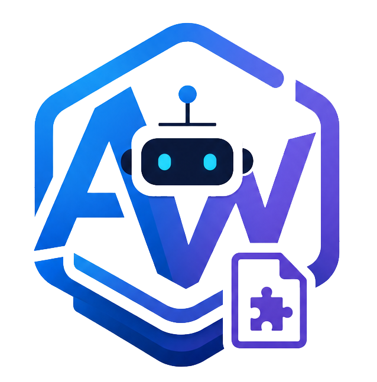

<div align="center">
  

  # AWBotHub

  一个支持 Telegram Bot 与用户账号的插件管理系统。安装、配置、更新和运行插件都可以在网页里完成。
</div>

当前正式版为 **v2.0.2.8**。

第一次使用可从 [详细使用手册](docs/guide/Home.md) 开始。遇到问题时，请先查看 [常见问题](#常见问题) 和运行日志。

## 系统宣传片

2 分 30 秒了解系统主要功能，含配乐，无旁白。

https://github.com/user-attachments/assets/84ee9d34-f2c6-4883-8931-bebb4851f3e8

[下载 1080p 原片](https://github.com/AWdress/AWBotHub/releases/download/v2.0.2.7/AWBotNest-Promo-1080p.mp4)

## 它能做什么

- **插件即功能**：想要什么功能就装什么插件，开关一点立即生效。
- **插件市场**：内置官方插件仓库，也能添加你自己的 GitHub 仓库，浏览后一键安装。
- **多账号**：在网页上用手机号登录你的 Telegram 账号，可同时管理多个，随时上线/下线。
- **多 Bot 与路由**：可以接入多个 Telegram Bot，并为不同插件指定发送账号和通知渠道。
- **AI 服务**：统一配置文字、识图和生图模型，支持自动识别 Chat Completions、Responses 和 Anthropic Messages；插件无需保存 API Key，也能限制每个插件可用的能力。
- **系统助手**：查询状态和插件日志，按步骤调用已授权的插件动作；支持会话、确认、记忆、技能和预约任务。使用方法见[系统助手](docs/ASSISTANT.md)。
- **Cookie 服务**：支持浏览器 CookieCloud 直连和远程 CookieCloud 定时同步，插件按授权域名读取。
- **插件管理更完整**：支持版本更新、热重载、自检、运行诊断、日志查看和 Vue 配置界面。
- **开放 API**：可以让自动化脚本或其他服务管理插件、读取状态和发送 Telegram 消息。
- **网页管理**：插件、账号、日志、定时任务和设置，全在一个深色界面里管理。
- **安全可控**：插件从市场下载后不会自动运行，必须你亲手开启才生效。

## 安装运行（推荐 Docker）

请使用独立的数据目录，只导入与当前系统兼容的配置和备份。

Docker 镜像支持 Linux x86_64（`amd64`）和 ARM64（`arm64`），版本标签与 `latest` 使用同一组多架构镜像。64 位 ARM 服务器、NAS 和树莓派可使用；不支持 32 位 ARM 系统。插件的第三方依赖仍需支持对应架构。

CloakBrowser 浏览器缓存默认保存在 `data/cloakbrowser`（容器内 `/app/data/cloakbrowser`），随 `data` 映射持久化，同版本完整缓存可在容器重建后复用。所需版本未缓存时会自动下载。可通过 `CLOAKBROWSER_CACHE_DIR` 覆盖目录，自定义目录需自行挂载。此设置不改变镜像内 Playwright Chromium 的安装位置。

在 Linux 服务器执行下面这一条命令：

```bash
curl -fsSL https://raw.githubusercontent.com/AWdress/AWBotHub/main/install.sh | sudo bash
```

运行后会询问安装位置、网络模式和端口。默认使用 Docker bridge 模式，宿主访问端口和容器内系统监听端口都可以单独设置；选择 `host` 模式时不做端口映射，系统会直接监听你设置的端口。直接按回车会使用默认目录 `/opt/AWBotNest`、bridge 模式和端口 `18001`。脚本会自动检查并安装 Docker、按 Docker 服务器架构拉取对应镜像、创建持久化目录并启动 AWBotHub，ARM64 与 x86_64 使用同一条安装命令。

也可以用环境变量跳过交互，例如：

```bash
curl -fsSL https://raw.githubusercontent.com/AWdress/AWBotHub/main/install.sh | \
  sudo -E env AWBOTNEST_MODE=host AWBOTNEST_PLATFORM_PORT=19001 bash
```

bridge 模式可同时设置 `AWBOTNEST_PORT`（宿主映射端口）和 `AWBOTNEST_PLATFORM_PORT`（容器内系统端口）。host 模式只使用 `AWBOTNEST_PLATFORM_PORT`。

运行数据会保存在你选择的安装目录中。以后重新执行同一条命令并选择原来的目录，即可拉取最新镜像并更新容器，已有数据不会丢失。

> 如果已经安装 Docker，脚本会直接使用，不会重复安装。需要调整代理或其他高级选项时，可以编辑所选安装目录里的 `docker-compose.yml`，然后在该目录执行 `docker compose up -d`。

## 第一次使用

1. **设置管理员账号**：首次打开网页时，直接设置管理员用户名和密码，保存后自动进入。
2. **填 Telegram 凭据**：到「系统设置 → Telegram 凭据」，填入从 [my.telegram.org](https://my.telegram.org) 申请的 `API_ID` / `API_HASH`。需要 Bot 时，再添加 [@BotFather](https://t.me/BotFather) 给出的 Bot Token。保存后重启生效。
3. **登录你的 Telegram 账号**：到「账号管理」，按提示输入手机号 → 验证码 →（如有）两步验证密码，完成登录。
4. **装插件**：到「插件管理 → 插件市场」，挑想要的插件点「安装」，再回「我的插件」打开它的开关。

## 日常使用

- **插件管理**：`我的插件`查看、开关、配置、更新和删除插件；`插件市场`浏览并安装新插件。插件异常时可以直接查看日志、自检或运行诊断。
- **账号管理**：登录、查看、上线下线和删除 Telegram 用户账号，并管理多个 Bot。
- **运行日志**：实时查看系统和插件的运行日志，可按级别/关键词过滤。
- **系统状态**：查看 CPU、内存、账号在线情况、已加载插件、定时任务和插件使用趋势。
- **AI 服务**：添加 OpenAI 或 Anthropic 兼容服务，选择或自动识别接口协议，查看最近调用、失败分类及插件用量，并分配文字、识图和生图模型。
- **Cookie 服务**：配置浏览器直连或远程同步，查看 Cookie 数量、同步状态与最近同步记录。
- **通知服务**：支持 Telegram、企业微信、Bark 和 Webhook，并能为插件单独设置通知路由。
- **系统设置**：管理登录密码、Telegram 凭据、网页端口、代理、插件仓库、开放 API 和备份恢复。

### 企业微信接收指令

在「系统设置 → 通知服务」添加企业微信自建应用，填写企业 ID、应用 Secret 和 AgentID。
打开「消息回调」，填写回调 Token、EncodingAESKey 和允许操作的成员 UserID，保存后复制回调地址。
在企业微信管理后台的应用「接收消息 → 设置 API 接收」中填入相同的 Token、EncodingAESKey 和回调地址。
地址必须能从公网通过 HTTPS 访问；从外部访问系统设置页复制地址，不要使用本机的 `127.0.0.1` 地址。

给应用发送 `/帮助` 可查看指令，`/插件` 可查看此渠道关联的插件和动作。
执行格式为 `/运行 插件ID 动作名`，例如 `/运行 my_feature test`；需要参数时附 JSON 对象：
`/运行 my_feature test {"account": "demo"}`。执行结果只回复给发起成员，不发送到全部通知接收人。

仅支持插件通过 `ctx.action()` 注册的动作，Telegram 专用指令不会自动转成企业微信指令。
成员 UserID 是企业微信通讯录中的账号 ID，不是昵称；多个成员用 `|` 分隔。
关闭接收消息后，企业微信通知仍可使用。消息重试不会重复执行；系统停止时会取消排队任务，不在重启后自动重跑。

## 想自己写插件？

开发教程和示例见 [插件开发指南](docs/PLUGIN_GUIDE.md)，对接其他服务见 [API 文档](docs/API.md)。

## 常见问题

**忘了密码？** 不用重装，按下面三步重设：

1. 临时限制公网访问，停止系统。
2. 备份 `data/config.json`，打开原文件，将 `admin_salt`、`admin_password_hash`、`admin_token` 三项的值都改成 `""`（空字符串），其他内容不要动。
3. 启动系统，刷新页面重新设置管理员账号，完成后再恢复公网访问。

**不要删除整个配置文件。** 这样重置会保留插件和数据。若手动设置过 `AWBOTNEST_ADMIN_TOKEN` 环境变量，还需移除该变量并重建容器。

**装了插件但没反应？** 插件下载后默认是关闭的，要去「我的插件」打开开关。

**插件报错/标红？** 打开插件菜单中的「查看日志」「插件自检」或「运行诊断」，可以直接查看失败原因，不影响系统和其他插件。

**AI 服务为什么不能用？** 读取服务商模型后，需要把模型添加到模型库，勾选能力，再到“模型分工”设置默认模型。文字调用仍失败时，可在服务商设置中固定实际接口格式，并从“最近调用”查看协议、状态码和错误分类。

**CookieCloud 配置好了但没有数据？** 点击“检查状态”查看结果；浏览器直连需要在扩展中选择上传到服务器，远程模式可以点击“立即同步”。

**数据存在哪？** 设置和插件数据在 `data/`，Telegram 登录状态在 `sessions/`，已安装插件在 `plugins/`。备份这三个目录就等于备份了全部数据。

---

完整使用说明见 [详细使用手册](docs/guide/Home.md)，接口与插件开发说明见 [docs/](docs/)。
