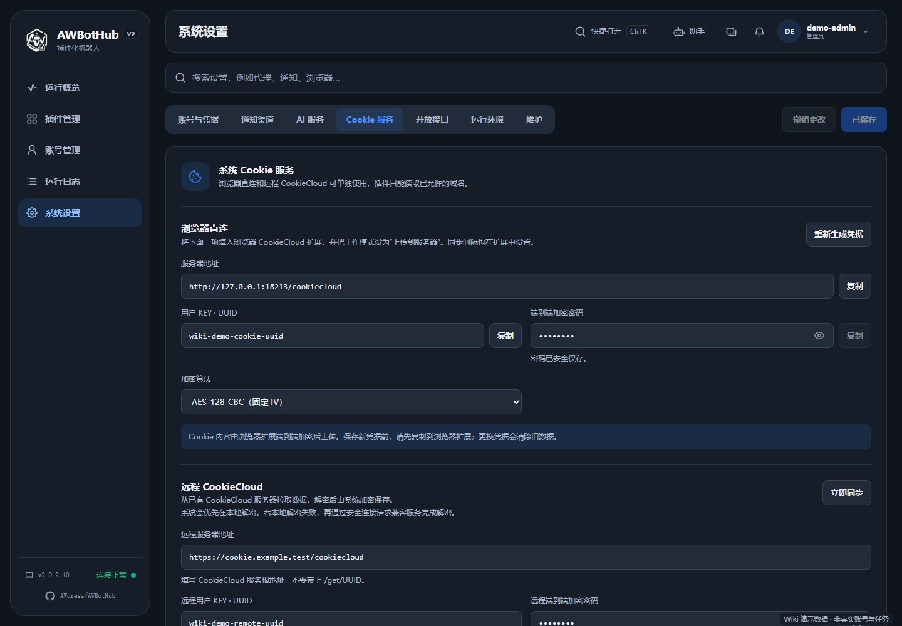

# Cookie 同步与浏览器服务

本章按 **v2.0.2.10** 的设置说明，包括两项不同的功能：

- **Cookie 服务：** 把浏览器中已登录网站的 Cookie 同步到系统，供已获授权的插件读取。
- **浏览器仿真：** 插件需要打开真实网页、执行 JavaScript 或进行页面交互时，使用 CloakBrowser。

同步 Cookie 与浏览器操作是两项独立功能。镜像已包含浏览器，但不会自动让所有网站登录成功，具体登录、验证和签到流程仍由插件实现。

## 1. Cookie 是什么，要注意什么？

Cookie 是网站保存在浏览器中的一类数据，经常包含登录状态。拿到有效 Cookie 的人可能在不输入密码的情况下访问你的账号。

因此：

- 不要把 Cookie、CookieCloud 加密密码或同步凭据发到公开群、issue、日志截图里。
- 尽量只同步插件需要的网站，避免把整个日常浏览器的所有网站登录状态都交给系统。
- 管理网页和 CookieCloud 地址尽量使用 HTTPS。不要把登录凭据通过未加密公网 HTTP 传输。
- 系统按插件声明/授权的域名提供 Cookie，插件仍然必须来自可信来源。

## 2. 选“浏览器直连”还是“远程 CookieCloud”？

| 你的情况 | 选择 |
| --- | --- |
| 还没有 CookieCloud 服务器，希望直接同步到 AWBotHub | 浏览器直连 |
| 已经有一个 CookieCloud 服务器，浏览器正在往那里上传 | 远程 CookieCloud |
| 想两个来源一起使用 | 支持，但最后完成的一次同步会替换系统 Cookie 数据；建议先只选一个来源 |

这两个区域没有必须先开启的总开关。**直连填好 UUID 与密码即可使用；远程地址、UUID、密码完整并保存后，按间隔自动同步。** 远程配置不依赖直连区域先生成凭据。



> 数据目录中的配置和解密后的 Cookie 目前以明文 JSON 保存，网页里的星号只是隐藏显示。请限制数据目录的访问权限，备份也按敏感资料保管。重新生成直连凭据会立即生效，但不会清空已有 Cookie。

## 3. 浏览器直连：推荐的新手配置步骤

### 3.1 安装 CookieCloud 扩展

在你平时登录目标网站的桌面浏览器中安装 [CookieCloud 官方项目提供的扩展](https://github.com/easychen/CookieCloud)。请核对发布来源，不要安装名字相似但来源不明的扩展。

扩展负责从**这个浏览器**读取 Cookie 并上传。服务器不会远程读取你手机或电脑浏览器里的 Cookie。

### 3.2 在系统生成连接凭据

1. 打开「系统设置 → Cookie 服务」。
2. 在「浏览器直连」点击「重新生成凭据」。首次没有凭据时也使用此按钮。
3. 记录界面提供的三项：

| 系统字段 | 在扩展中对应填写 |
| --- | --- |
| 服务器地址 | CookieCloud 服务器地址 |
| 用户 KEY · UUID | 用户 KEY / UUID |
| 端到端加密密码 | 加密密码 |

4. 将这三项填进扩展，**工作模式选择“上传到服务器”**。
5. 系统中的「加密算法」与扩展算法保持一致。可选 AES-128-CBC（固定 IV）和 CryptoJS（兼容模式）；不要只改一边。
6. 检查并保存系统设置、扩展设置。

系统给出的直连地址末尾为 `/cookiecloud`，例如：

```text
https://你的系统域名/cookiecloud
```

这是示意。复制你自己页面中的实际地址，不要额外拼上 `/get/UUID`。

> “重新生成凭据”会立即更换系统保存的 UUID 和密码，不是刷新按钮。已有同步正在使用时，更换后必须同步修改扩展配置。旧 Cookie 不会因此自动清空；看到旧同步数据，不代表新凭据已经上传成功。

### 3.3 让浏览器上传一次

1. 在装有扩展的这个浏览器中登录插件需要的网站。
2. 在 CookieCloud 扩展中按需设置同步域名与自动上传间隔。界面名称以扩展版本为准。
3. 使用扩展提供的同步/上传操作，或等待它的自动上传间隔。
4. 回系统查看「同步状态」，点击「检查状态」。

**成功现象：** 页面能看到最近同步时间、域名数量、Cookie 数量；下方同步记录和运行日志有结果。仅“凭据已保存”不代表浏览器已经上传。

扩展只能在浏览器和扩展运行时按其规则上传。电脑关机、浏览器关闭或扩展停用后，不能指望它继续定时更新。直连同步间隔在扩展中配置，不是远程 CookieCloud 的间隔。

## 4. 远程 CookieCloud：复用已有服务器

如果已有 CookieCloud 服务，不用搬走它，也不用让浏览器改为直接上传到 AWBotHub。

1. 打开「系统设置 → Cookie 服务 → 远程 CookieCloud」。
2. 填「远程服务器地址」：填写现有 CookieCloud 的**服务根地址**。如果服务部署在 `/cookiecloud` 子路径，应保留该子路径，但不要附加 `/get/UUID`。
3. 填「远程用户 KEY · UUID」和「远程端到端加密密码」，必须与浏览器扩展/远程服务现有配置一致。
4. 「远程加密算法」先选「自动识别（推荐）」；确知加密格式时可以固定。
5. 选择「自动同步间隔」，界面提供每 5 分钟至每天的选项。
6. 按需填「同步域名白名单（可空）」，如 `example.com, *.example.org`。多个用逗号或空格分隔；留空会同步远程的全部域名，不是“不同步”。
7. 保存设置。填写完整后会注册自动同步；要马上验证，点击「立即同步」。有未保存改动时，此按钮会先保存再执行。
8. 查看同步状态、域名和下方记录。

**正常现象：** 提示“远程 CookieCloud 同步完成”，状态显示同步数据和时间。后续系统按保存的间隔拉取，不需要每次打开网页。

远程地址、UUID 和密码保存在系统配置中，不会作为正常 Cookie 读取接口的返回值提供给插件。**网页掩码不代表磁盘文件已加密**；系统配置和解密后的 Cookie 文件都需要按敏感资料保护。

系统先尝试本地解密；失败时，可能把加密密码发送给远程服务，请求兼容解密。务必使用可信的 HTTPS 服务，不要向不可信服务提交自己的同步密码。

如果不想继续自动拉取，可以清空远程必填连接项并保存。仅关闭网页不会停止后台同步。

### 同时使用直连和远程会发生什么？

两种来源都可写入同一个 Cookie 存储。一次同步不是把所有来源无限累加，而是由最后完成的同步替换数据。如果两个来源的域名不一样，就可能出现“刚同步后有，另一边同步后又没了”。新手建议只保留一个主要来源。

## 5. “检查状态”和“清空数据”分别做什么？

- **检查状态：** 检查系统当前保存的 Cookie 及数量，不会让你的电脑浏览器立即上传，也不等同于验证每个网站的登录有效性。
- **立即同步：** 主动从已保存的远程 CookieCloud 拉取一次。
- **清空数据：** 删除系统保存的 Cookie，插件会暂时无法读取。不会替你退出电脑浏览器中的网站；下一次同步可以重新写入。

某个网站仍提示未登录时，即使系统显示有很多 Cookie，也要检查对应域名是否真的同步、Cookie 是否过期、插件是否被授权访问该域名。

## 6. 为什么插件读不到已经同步的 Cookie？

按这个顺序排查：

1. **来源是否真的上传/拉取成功？** 看最近同步时间和错误，而不是只看“设置已保存”。
2. **域名对不对？** `example.com`、`www.example.com` 和其他子域名可能涉及不同 Cookie；远程白名单也可能过滤掉目标。
3. **浏览器是否在正确的网站账号登录？** Cookie 来自扩展所在浏览器，不是任意设备。
4. **插件有没有使用系统 Cookie 接口？** 未适配的插件可能仍要求自己填写 Cookie。
5. **插件有没有声明所需域名权限？** 系统不会把所有 Cookie 无条件交给每个插件，需要开发者适配。
6. **Cookie 有没有失效？** 网站退出、修改密码、撤销会话或风控后，旧 Cookie 可能不再有效。重新登录网站并同步。

域名授权和开发接口见 [插件开发](Plugin-Development.md)。

## 7. 浏览器仿真：CloakBrowser

入口：「系统设置 → 运行环境 → 浏览器仿真」。

系统浏览器服务统一使用 CloakBrowser，镜像已包含组件 **0.5.12** 及当前架构的内核，不需要再选择引擎、另外安装组件、下载内核或填写 CloakBrowser Key。

系统不会改写插件业务逻辑。插件如果明确直接使用自己指定的浏览器库、浏览器参数或外部服务，仍需按作者的说明配置。

### 第一次使用

1. 到“浏览器仿真”查看组件和内核版本。
2. 按插件要求配置账号、Cookie、代理或其他业务参数。
3. 调用一次插件的浏览器功能，查看日志中的启动和页面操作结果；不要重复启停或同时重启。

浏览器已安装不等于业务配置完成，也不保证所有网站的登录或验证都会成功。插件自身依赖、GeoIP 数据库或其他资源仍可能有各自的准备步骤，以实际日志为准。

## 8. 架构与内核通道

组件版本均为 **0.5.12**，内核按容器实际架构提供：

| 架构 | Stable | Preview |
| --- | --- | --- |
| AMD64 / x86_64 | 156.0.8078.47.1 | 156.0.8078.47.3 |
| ARM64 / aarch64 | 155.0.8059.39.2 | 156.0.8078.47.1 |

两种架构都包含 Stable 和 Preview，但通道对应的版本不同，不能按另一个架构的版本号选择。不要把 AMD64 的内核复制到 ARM64 环境使用。

系统授权决定可使用的插件范围，与浏览器版本不是同一个设置。不要把系统激活码填入插件的浏览器 Key 或其他密钥字段。

## 9. 多个插件怎样共用浏览器？

镜像内置的 CloakBrowser 支持多个会话同时运行，不同插件可以同时使用浏览器。

插件任务自身的并发、超时和队列限制仍然有效；管理员停用、取消以及插件自己设置的超时仍可能终止任务。浏览器同时运行得越多，内存峰值也可能越高，内存较小的设备可将重型任务的定时错开。

注意边界：

- 插件要在 `finally` 中正常关闭 `browser.close()`，或关闭持有会话的 `context.close()`；只关闭网页 Page 不够。异步接口需要 `await`，插件开发者仍要正确清理资源。
- 强杀、进程崩溃或网络异常可能中断清理，不要连续强制重启来催任务。
- 插件独立创建的外部环境或浏览器，应按作者说明检查。
- 支持并发不等于保证任务成功。插件显式取消/超时、系统停止或任务本身出错，都可能结束这次任务。

任务运行情况和等待阶段可到“运行概览”的定时任务区域及“运行日志”中查看。看到等待时，要区分同一任务尚未结束、插件执行名额不足和外部请求较慢。

## 10. “组件版本”和“内核版本”是两回事

| 页面显示 | 代表什么 |
| --- | --- |
| 组件 `0.5.12` | Python 的 `cloakbrowser` 包，负责启动等逻辑 |
| Stable 内核 / Preview 内核 `155…`、`156…` | 真正打开网页的浏览器程序版本，按架构和通道提供 |

不能用组件 `0.5.12` 和内核 `155…`、`156…` 比大小，它们不是同一套版本号。查看版本时，要同时核对组件、架构和内核通道。

### 浏览器怎样更新

镜像中的组件与内核只随系统镜像更新，浏览器没有单独的在线更新入口或后台更新检查。需要新版本时，先阅读系统发布说明，备份后拉取并更新系统镜像；不要在运行中的容器内手动升级组件或替换内核。

系统仍会按既定设置检查 AWBotHub 新版本；检查到更新不等于已经替你更新镜像。操作见 [备份与维护](Maintenance.md)。

## 11. 数据目录、已有缓存与代理

镜像中的浏览器组件和内核不依赖 `data` 目录另行安装。插件的其他 Python 依赖、数据库及浏览器缓存仍可能使用以下持久化位置：

```text
/app/data/plugin_deps/    插件的其他 Python 依赖
/app/data/cloakbrowser/  浏览器相关缓存、GeoIP 等数据，以及已有的内核缓存
```

对应宿主机位置取决于你把 `data/` 挂载到哪里，不能直接把容器路径当作宿主机路径操作。

**更新镜像不会自动删除数据目录里已有的组件或内核缓存。** 不要为了节省空间直接清空整个 `data`、`plugin_deps` 或 `cloakbrowser` 目录；其他插件可能仍在使用其中内容。需要整理时，先备份并核对路径、用途及正在运行的任务。

系统运行代理仍用于支持代理的联网请求；插件明确传入的网络参数优先。pip 镜像源只影响需要安装的 Python 包，不会把网站请求或所有资源下载改为从该镜像源访问。

## 12. 常见问题速查

| 现象 | 检查方法 |
| --- | --- |
| `geoip2 is required for geoip=True` | 核对系统镜像版本、架构及插件是否使用独立环境；不要直接覆盖镜像内组件 |
| 插件仍要求下载 CloakBrowser 或填写 Key | 查看插件是否绕过系统浏览器服务、使用独立环境或固定了其他版本，提供脱敏日志给作者排查 |
| 插件指定的浏览器版本不可用 | 按当前架构核对上表，通道与版本必须配套；不要使用另一架构的版本号 |
| 任务显示等待 | 核对系统版本、同一任务是否尚未结束，以及插件自身的并发和队列设置；等待不等于定时任务没触发 |
| Cookie 数量正常，插件仍未登录 | 检查目标域名、Cookie 有效期、插件域名权限与是否使用系统 Cookie 服务 |
| 直连一直没有同步数据 | 扩展模式是否为上传到服务器、地址能否从浏览器访问、凭据和算法是否一致、浏览器是否运行 |
| 远程同步失败 | 地址是否是根路径、UUID/密码是否配套、算法和 HTTPS、系统服务器/代理能否访问远程 |
| 重建容器后插件又下载其他依赖 | 核对 `data/` 挂载和具体下载资源；系统浏览器内核已在镜像中，其他插件资源不一定包含 |

仍无法定位时，提供系统版本、AMD64/ARM64 架构、部署方式、组件/内核版本以及脱敏安装日志，见 [故障排查](Troubleshooting.md)。不要提交完整 Key 或 Cookie。

---

[返回首页](Home.md) · [安装部署](Installation.md) · [插件使用](Plugins.md) · [网络与通知](Accounts-and-Notifications.md) · [备份与维护](Maintenance.md) · [插件开发](Plugin-Development.md)
